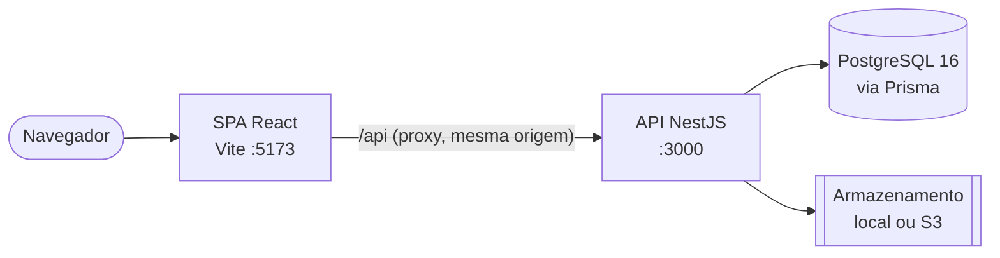

<div align="center">

# RiderSync

**Do rider ao palco.**
Plataforma de profissionalização artística para músicos, bandas e casas de show de Alagoas.


[Funcionalidades](#funcionalidades) ·
[Stack](#stack) ·
[Como rodar](#como-rodar-em-desenvolvimento) ·
[Docker](#aplicação-completa-via-docker-compose) ·
[Contas de demonstração](#contas-de-demonstração) ·
[Comandos](#comandos) ·
[Documentação](#documentação)

</div>

---

## Sobre

O RiderSync conecta quem toca com quem contrata. Artistas mantêm perfil profissional, portfólio e rider técnico;
casas de show cadastram o inventário do palco e publicam oportunidades; e as duas pontas negociam dentro da
plataforma, com propostas, contrapropostas, mensagens e confirmação de contratação.

> [!NOTE]
> **MVP v1.1.** Editais e oportunidades culturais estão **adiados**. A plataforma **não processa pagamentos**:
> valores e condições são combinados entre as partes.

## Funcionalidades

| | |
|---|---|
| **Perfis profissionais** | Músicos (solo) e bandas, com portfólio e integrantes por papel |
| **Rider técnico** | Itens de um catálogo técnico, com quantidade e observações |
| **Inventário da casa** | Equipamentos do palco cadastrados por casa de show |
| **Compatibilidade** | Comparação item a item entre o rider do artista e o inventário da casa |
| **Oportunidades** | Casas publicam vagas de apresentação; artistas se candidatam |
| **Negociações** | Propostas, contrapropostas, mensagens e confirmação da contratação |

## Stack

| Camada | Tecnologias |
|---|---|
| **Frontend** | React 19 · TypeScript · Vite (SPA responsiva) · React Router · TanStack Query · React Hook Form + Zod |
| **Backend** | NestJS 11 em **um único monólito modular** · REST + Swagger · Zod |
| **Dados** | PostgreSQL 16 · Prisma 6 (migrations versionadas) |
| **Testes** | Jest + Supertest (API) · Vitest (UI) · Playwright (E2E) |
| **Ambiente** | Docker Compose |



<details>
<summary><b>Estrutura do repositório</b></summary>

```
.
├── backend/                 API NestJS
│   ├── prisma/              schema.prisma + migrations (inclui CHECKs e catálogo técnico)
│   ├── src/common/          validação Zod, erros, regras de membership
│   ├── src/modules/         auth, account, access, media, artists, bands, organizations,
│   │                        marketplace, riders, events, bookings, dashboard
│   ├── src/seed/            seed de demonstração (somente desenvolvimento)
│   └── test/                testes de integração (Supertest + PostgreSQL)
├── frontend/                SPA React
│   ├── src/features/        telas por domínio
│   ├── src/components/      layout, campos, estados, diálogos
│   └── e2e/                 testes Playwright
├── docs/                    decisões, progresso, demonstração, referências
└── docker-compose.yml       db + api + web
```

</details>

## Pré-requisitos

| Ferramenta | Versão | Para quê |
|---|---|---|
| Node.js | 22 LTS (≥ 22.12) | rodar backend e frontend |
| npm | 10+ (vem com o Node) | instalar dependências |
| Docker + Compose v2 (ou Podman) | recente | subir o PostgreSQL e, se quiser, a aplicação inteira |

Confira com `node -v`, `npm -v` e `docker compose version`.

> [!TIP]
> Não precisa instalar PostgreSQL: o banco roda num container pelo `docker compose`.
> Usa Podman? Veja [Usando Podman](#usando-podman-em-vez-de-docker).

## Como rodar em desenvolvimento

Execute tudo **na raiz do repositório**, salvo indicação. No final você terá **dois terminais**: um para a API e
outro para a interface.

### 1. Clonar e instalar (uma vez)

```bash
git clone git@github.com:leonardobrrs/ridersync.git
cd ridersync
npm ci
```

O `npm ci` instala backend e frontend de uma vez (npm workspaces, lockfile único na raiz) e gera o Prisma Client
automaticamente (`postinstall` do backend).

### 2. Criar o ambiente do backend (uma vez)

```bash
cp backend/.env.example backend/.env
```

Os valores padrão já funcionam com o banco do `docker compose` (usuário `ridersync`, senha `ridersync_dev_only`,
porta `5432`). O `backend/.env` não é versionado.

<details>
<summary>Vai rodar os testes de integração? Crie também o <code>backend/.env.test</code></summary>

```bash
sed 's#/ridersync?#/ridersync_test?#; s#NODE_ENV=development#NODE_ENV=test#; s#./storage#./test-storage#' \
  backend/.env.example > backend/.env.test
echo "THROTTLE_AUTH_LIMIT=10000" >> backend/.env.test
```

</details>

### 3. Subir o banco

```bash
npm run db:up        # = docker compose up -d db
```

Sobe o PostgreSQL 16 em `localhost:5432`. Na primeira vez, também cria os bancos `ridersync_test` (integração) e
`ridersync_e2e` (Playwright). Os dados ficam no volume `ridersync_db-data`. Confira com `docker compose ps`: o
serviço `db` deve aparecer como `healthy`.

### 4. Aplicar as migrations (e, se quiser, os dados de demonstração)

```bash
npm run db:migrate   # prisma migrate deploy — cria/atualiza tabelas, não apaga dados
npm run db:seed      # opcional: contas e dados FICTÍCIOS
```

Rode `npm run db:migrate` sempre que baixar código com migrations novas. O seed é idempotente.

### 5. Backend (terminal 1)

```bash
npm run dev:api
```

| | |
|---|---|
| API | http://localhost:3000/api (recarrega ao salvar `backend/src`) |
| Swagger | http://localhost:3000/api/docs |
| Teste rápido | `curl http://localhost:3000/api/health` → `{"status":"ok"}` |

### 6. Frontend (terminal 2)

```bash
npm run dev:web
```

- Interface em **http://localhost:5173**.
- O Vite encaminha `/api` para `http://localhost:3000` (mesma origem), então o login por cookie funciona sem
  configurar CORS. **A API precisa estar rodando.**
- Para apontar para outra API: `VITE_API_PROXY=http://localhost:3200 npm run dev:web`.

Pronto: crie uma conta em http://localhost:5173/cadastro ou entre com uma
[conta de demonstração](#contas-de-demonstração).

### Dia a dia

```bash
npm run db:up        # se o banco estiver parado
npm run dev:api      # terminal 1
npm run dev:web      # terminal 2
```

Para parar: `Ctrl+C` nos terminais e `docker compose stop db` (os dados são mantidos).

<details>
<summary><b>Alternativa: rodar cada parte de dentro da própria pasta</b></summary>

```bash
# backend
cd backend
npx prisma migrate deploy          # migrations
npm run start:dev                  # API em modo watch (:3000)
npm run build && npm start         # ou: build de produção + execução

# frontend
cd frontend
npm run dev                        # Vite (:5173)
npm run build && npm run preview   # build de produção em :4173 (também com proxy de /api)
```

</details>

### Problemas comuns

| Sintoma | Causa provável / solução |
|---|---|
| `Configuração de ambiente inválida: DATABASE_URL` ao iniciar a API | falta o `backend/.env` (passo 2) |
| `Can't reach database server at localhost:5432` | banco parado: `npm run db:up`; veja `docker compose ps` |
| `port 5432 is already allocated` | já existe um PostgreSQL local: use `POSTGRES_PORT=5433 npm run db:up` e ajuste a porta em `DATABASE_URL` |
| Tela carrega, mas login e listas falham | a API não está rodando no :3000 (passo 5) |
| `Property 'PrismaClientKnownRequestError' does not exist` | client desatualizado: `npm run prisma:generate -w backend` |
| Erro `CSRF` ao chamar a API com curl/Postman | requisições de escrita exigem o cabeçalho `X-Requested-With: RiderSync` |
| `Port 5173 is in use` | outro Vite aberto; feche-o (a porta é fixa por causa do proxy/CORS) |

## Aplicação completa via Docker Compose

Sobe banco, API e frontend (nginx) em containers, sem Node local. Útil para demonstração:

```bash
docker compose up --build

# com dados de demonstração
API_NODE_ENV=development SEED_DEMO=true docker compose up --build
```

| | |
|---|---|
| Interface | http://localhost:8080 (o nginx encaminha `/api` para a API) |
| API direta | http://localhost:3000/api |

- O container da API executa `prisma migrate deploy` (não destrutivo) antes de iniciar.
- Portas configuráveis por `POSTGRES_PORT`, `API_PORT` e `WEB_PORT` (veja o `.env.example` da raiz). Se o
  `npm run dev:api` já estiver na porta 3000, use por exemplo `API_PORT=3200 docker compose up --build`.

> [!WARNING]
> Para parar use `docker compose down`. **Não** use `-v`: ele apaga o volume do banco.

## Usando Podman em vez de Docker

```bash
systemctl --user start podman.socket
export DOCKER_HOST=unix:///run/user/$UID/podman/podman.sock
docker compose up -d db      # o docker compose passa a usar o Podman
```

Em sistemas com SELinux (Fedora etc.), o bind mount do script de init já usa o rótulo `:z`.

## Contas de demonstração

Criadas por `npm run db:seed`, **somente em desenvolvimento**. Dados fictícios.
Senha de todas: `demo-ridersync-2026`.

| E-mail | Papel na demo |
|---|---|
| `ana@demo.ridersync.local` | Musicista com perfil público, OWNER da banda Maré Alta, recebeu proposta direta |
| `davi@demo.ridersync.local` | ADMIN da banda Maré Alta |
| `lia@demo.ridersync.local` | MEMBER da banda Maré Alta (só visualiza) |
| `joao@demo.ridersync.local` | Musicista com convite pendente para a Maré Alta |
| `bia@demo.ridersync.local` | Musicista em Penedo |
| `rafael@demo.ridersync.local` | OWNER da casa Galpão Jaraguá (inventário, evento aberto, candidatura e proposta) |
| `marina@demo.ridersync.local` | OWNER da casa Casa Sururu |

Roteiro passo a passo: [`docs/DEMO.md`](docs/DEMO.md).

## Comandos

| Comando (na raiz) | O que faz |
|---|---|
| `npm run lint` | ESLint no backend e no frontend |
| `npm run typecheck` | `tsc --noEmit` no backend e no frontend |
| `npm test` | Jest (unitários + integração no banco `ridersync_test`) e Vitest |
| `npm run test:e2e` | Playwright: sobe API (:3100) e SPA (:5174) isoladas no banco `ridersync_e2e` |
| `npm run build` | build de produção da API e da SPA |

Na primeira execução do E2E, rode `npx -w frontend playwright install chromium`. O E2E sobe a própria API e SPA e
não reaproveita os servidores de desenvolvimento, mas o banco (`npm run db:up`) precisa estar rodando.
Os testes de integração se recusam a rodar se `DATABASE_URL` não apontar para `ridersync_test` e só limpam dados
desse banco.

## Segurança

- Sessão no servidor com cookie `HttpOnly` e `SameSite=Lax` (`Secure` em produção)
- Senhas com scrypt
- Proteção CSRF por cabeçalho e verificação de origem; CORS por allowlist
- Autorização por vínculo no backend em todas as operações
- Validação Zod de toda entrada; uploads validados pela assinatura binária

Detalhes em [`docs/DECISOES_TECNICAS.md`](docs/DECISOES_TECNICAS.md).

## Variáveis de ambiente (backend)

Veja `backend/.env.example`. A API valida as variáveis ao iniciar.

| Variável | Uso |
|---|---|
| `DATABASE_URL` | conexão com o PostgreSQL |
| `CORS_ORIGINS` | origens permitidas |
| `COOKIE_SECURE` | use `true` sob HTTPS |
| `SESSION_TTL_HOURS` | duração da sessão |
| `STORAGE_DRIVER` · `S3_*` | armazenamento de mídia: `local` ou `s3` |
| `SEED_DEMO` | habilita o seed de demonstração |

## Documentação

| Documento | Conteúdo |
|---|---|
| [`docs/DECISOES_TECNICAS.md`](docs/DECISOES_TECNICAS.md) | modelo de dados, permissões, estados, segurança, armazenamento |
| [`docs/IMPLEMENTATION_PROGRESS.md`](docs/IMPLEMENTATION_PROGRESS.md) | progresso por fatia e resultados de testes |
| [`docs/DEMO.md`](docs/DEMO.md) | roteiro de demonstração |
| [`docs/NEON_SETUP.md`](docs/NEON_SETUP.md) | banco Neon (branch `ridersync-staging`), scripts `*:neon:staging` e pendências para a Vercel |
| [`docs/INSTRUCOES_IMPLEMENTACAO_RIDERSYNC_v1.1.txt`](docs/INSTRUCOES_IMPLEMENTACAO_RIDERSYNC_v1.1.txt) e `docs/references/` | referências de produto |
| Swagger | http://localhost:3000/api/docs |

---

<div align="center">
<sub>RiderSync · projeto acadêmico · Universidade Federal de Alagoas</sub>
</div>
