<p align="center">
  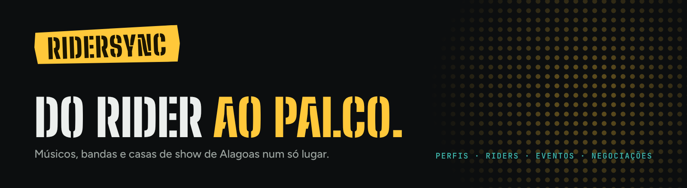
</p>

<p align="center">
  <b>Plataforma de profissionalização artística para músicos, bandas e contratantes de Alagoas.</b><br>
  Perfis profissionais, riders técnicos, inventário de palco, eventos, candidaturas e negociações num só lugar.
</p>

<p align="center">
  
  
  
  
  
  
  
  
  
</p>

<p align="center">
  <a href="#visão-geral">Visão geral</a> ·
  <a href="#funcionalidades">Funcionalidades</a> ·
  <a href="#como-a-contratação-funciona">Fluxo</a> ·
  <a href="#arquitetura">Arquitetura</a> ·
  <a href="#rodando-localmente">Rodar localmente</a> ·
  <a href="#contas-de-demonstração">Contas demo</a> ·
  <a href="#testes">Testes</a> ·
  <a href="#deploy">Deploy</a> ·
  <a href="#documentação">Docs</a>
</p>

> [!NOTE]
> Este README descreve a **versão atual** do RiderSync, desenvolvida na branch
> [`feat/evolucao-ridersync`](https://github.com/leonardobrrs/ridersync/tree/feat/evolucao-ridersync) e publicada no
> staging. Comandos como `db:seed:showcase` e os documentos linkados para essa branch passam a existir na `main`
> quando ela for incorporada.

<br>

<picture>
  <source media="(prefers-color-scheme: dark)" srcset="docs/images/readme/home-dark.png">
  <source media="(prefers-color-scheme: light)" srcset="docs/images/readme/home-light.png">
  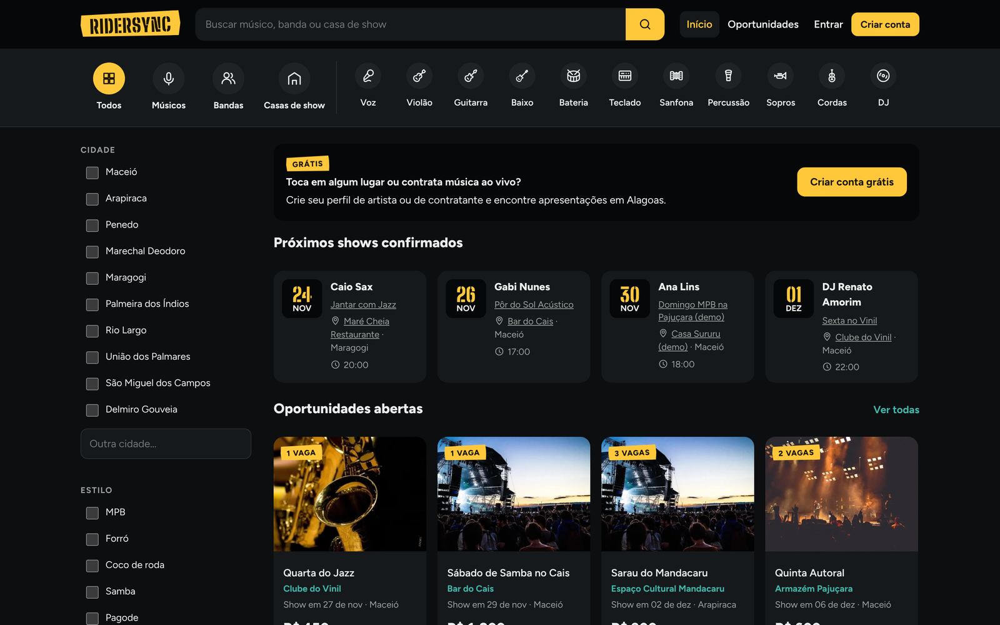
</picture>

<p align="center"><sub>Página inicial no tema do seu sistema (claro ou escuro). Dados fictícios do seed de vitrine.</sub></p>

---

## Visão geral

O RiderSync resolve um problema real da cena musical: quem toca e quem contrata conversam por mensagens soltas, sem saber
se o palco atende ao que o show precisa. Na plataforma, cada artista mantém um perfil profissional com portfólio e
**rider técnico**; cada casa de show cadastra o **inventário do palco**; e o sistema compara os dois item a item antes da
contratação. Eventos, candidaturas, propostas, mensagens e a confirmação do show ficam registrados para os dois lados.

| Para quem | O que faz no RiderSync |
|---|---|
| **Músicos** | Perfil profissional, portfólio com fotos e vídeos, rider técnico, candidaturas e negociações |
| **Bandas** | Perfil, portfólio e rider próprios, integrantes com função e papel, convites e transferência de propriedade |
| **Casas de show** | Perfil do espaço, inventário técnico, eventos públicos ou privados, análise de candidaturas e contratação |
| **Contratantes independentes** | Eventos particulares sem casa de show (aniversários, casamentos, festas) e contratação direta |
| **Visitantes** | Busca de artistas, bandas, casas e oportunidades, sem precisar de conta |

> [!IMPORTANT]
> O RiderSync **não processa pagamentos**: valores e condições são registrados na negociação e combinados entre as partes.

## Funcionalidades

### Vitrine pública

<table>
  <tr>
    <td width="50%">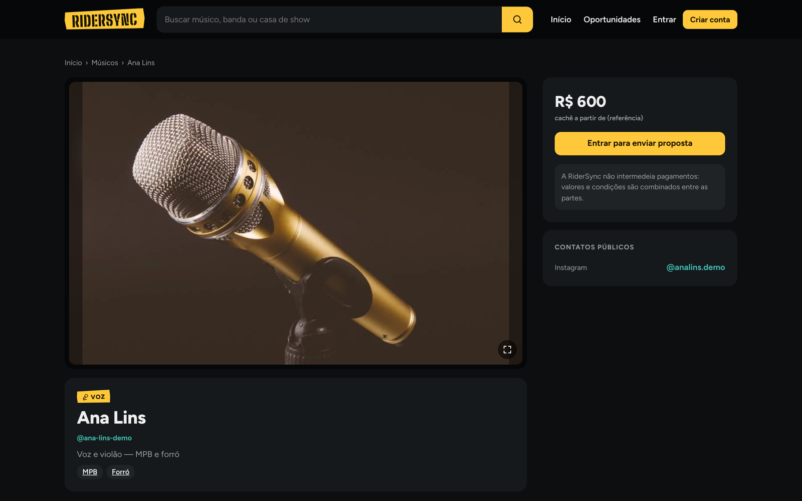</td>
    <td width="50%">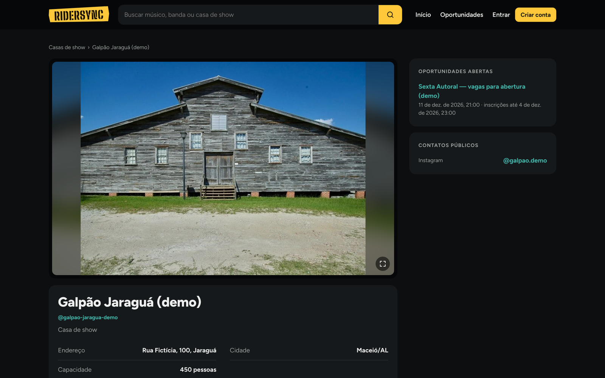</td>
  </tr>
  <tr>
    <td><b>Perfil público do artista.</b> Foto, cachê de referência, estilos, portfólio e rider em abas, próximos eventos (privados aparecem só como “Evento privado”).</td>
    <td><b>Perfil da casa de show.</b> Galeria, capacidade, endereço, contatos públicos e oportunidades abertas.</td>
  </tr>
  <tr>
    <td colspan="2">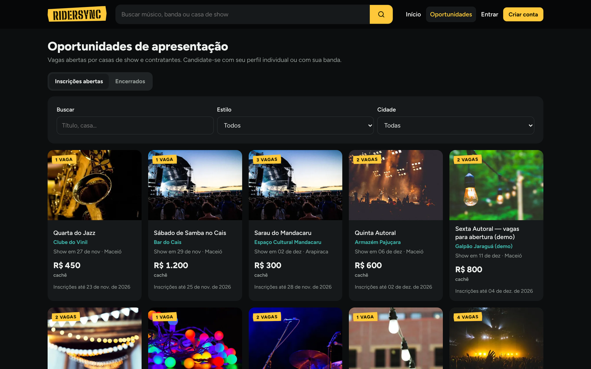</td>
  </tr>
  <tr>
    <td colspan="2"><b>Oportunidades.</b> Vagas abertas por casas e contratantes, com filtros por estilo e cidade, cachê e prazo de inscrição.</td>
  </tr>
</table>

- Busca por nome, instrumento, estilo e cidade, com categorias por instrumento e filtros combináveis
- Cidades restritas aos **102 municípios de Alagoas**, com preenchimento automático
- Miniaturas automáticas de vídeos do YouTube e do Vimeo no portfólio
- Perfis, integrantes, bandas e casas com `@` clicável

### Rider técnico e compatibilidade

<table>
  <tr>
    <td width="50%">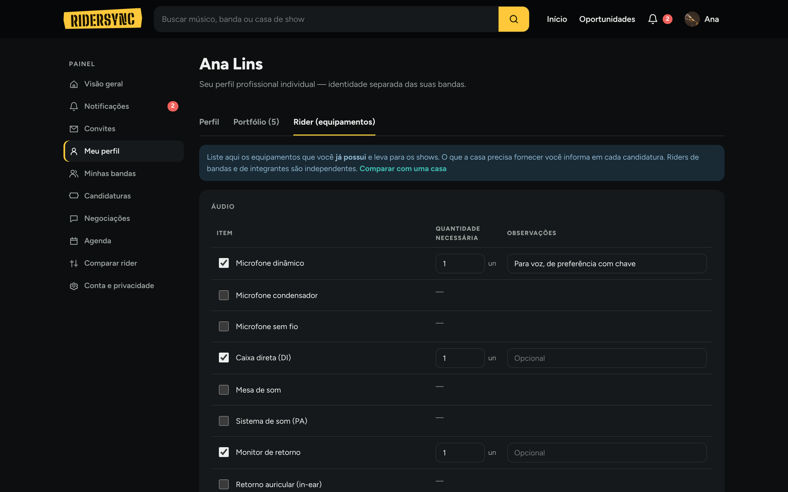</td>
    <td width="50%">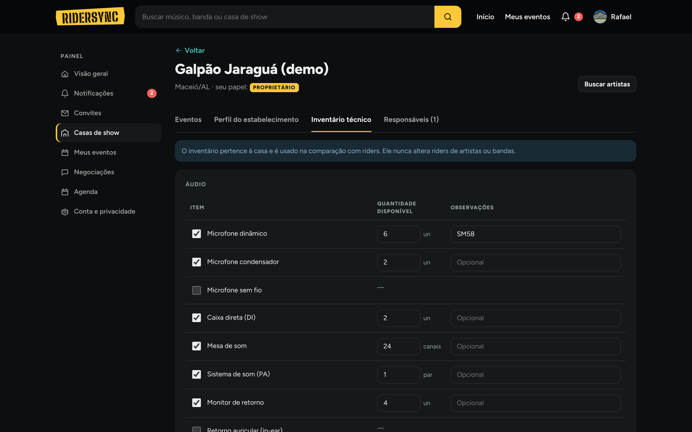</td>
  </tr>
  <tr>
    <td><b>Rider do artista.</b> Itens de um catálogo técnico, com quantidade e observações. Riders de banda e de integrantes são independentes.</td>
    <td><b>Inventário da casa.</b> O que o palco tem e em que quantidade. Nunca altera o rider dos artistas.</td>
  </tr>
  <tr>
    <td colspan="2">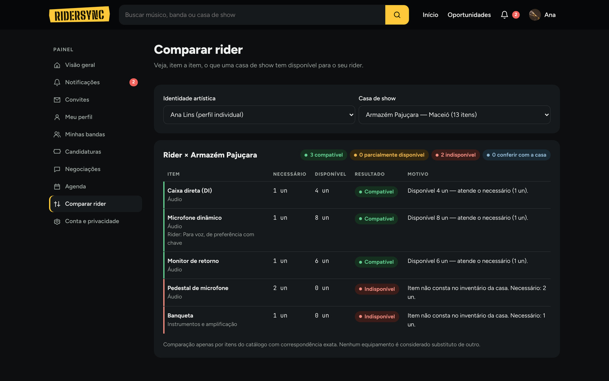</td>
  </tr>
  <tr>
    <td colspan="2"><b>Comparação determinística.</b> Cada item sai como <i>compatível</i>, <i>parcialmente disponível</i>, <i>indisponível</i> ou <i>conferir com a casa</i>, com quantidades e motivo. Só há correspondência exata de catálogo: nenhum equipamento é tratado como substituto de outro.</td>
  </tr>
</table>

### Painel, negociações e notificações

<table>
  <tr>
    <td width="50%">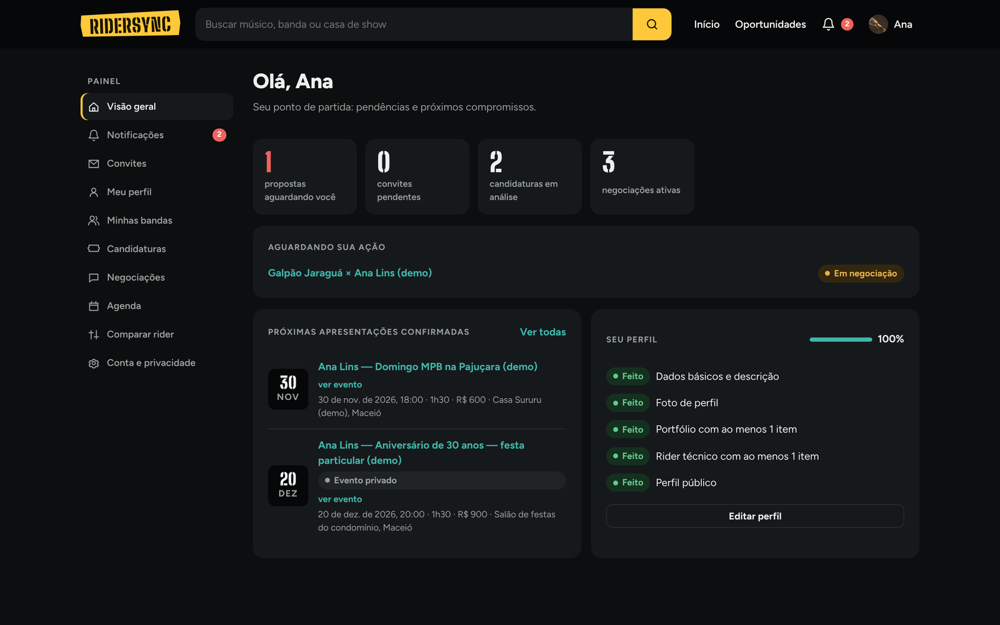</td>
    <td width="50%">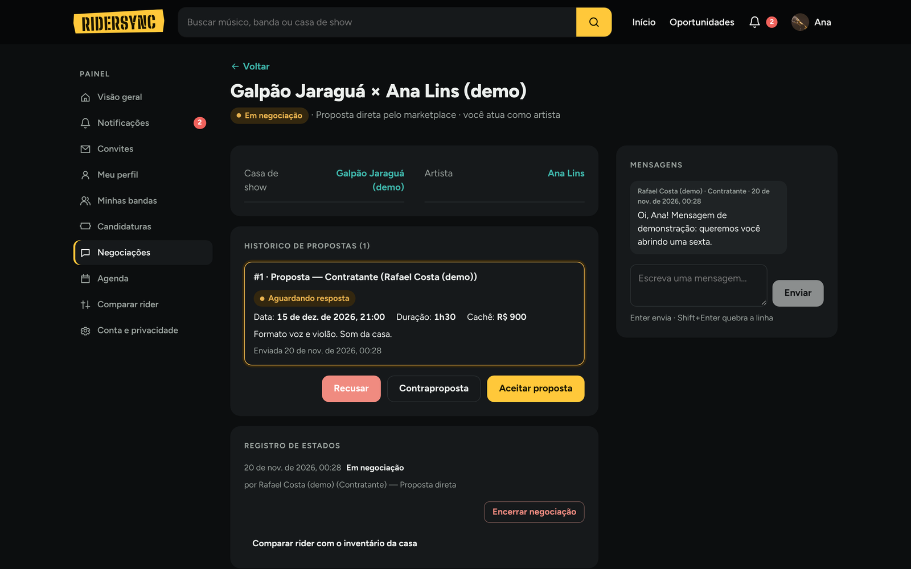</td>
  </tr>
  <tr>
    <td><b>Painel.</b> Pendências, convites, candidaturas em análise, próximas apresentações confirmadas e progresso do perfil.</td>
    <td><b>Negociação.</b> Proposta, contraproposta (a anterior fica no histórico), mensagens, aceite com modal próprio e confirmação explícita do contratante.</td>
  </tr>
  <tr>
    <td colspan="2">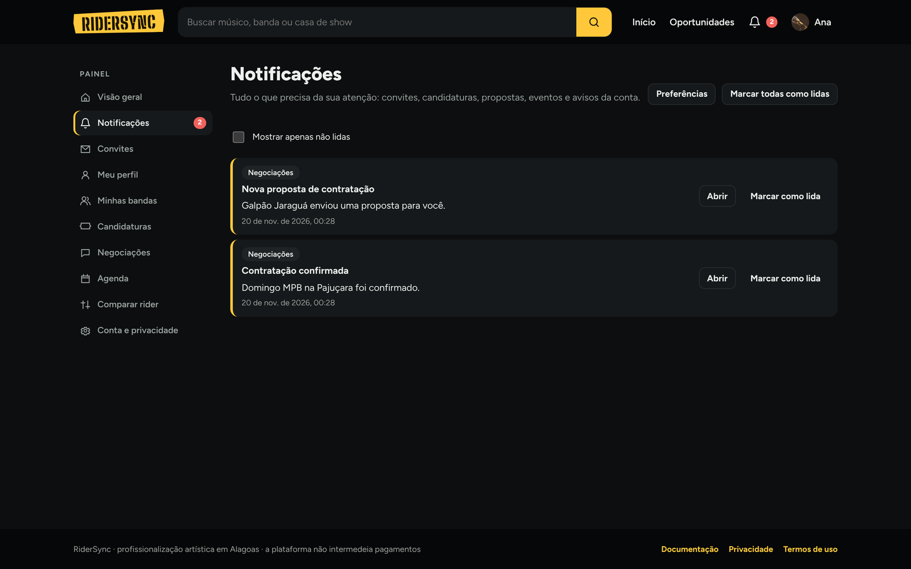</td>
  </tr>
  <tr>
    <td colspan="2"><b>Central de notificações.</b> Sino com tudo o que precisa de atenção, preferências por categoria e e-mails com descadastro em um clique.</td>
  </tr>
</table>

### Eventos e vagas

- Eventos **públicos ou privados**, com ou sem casa de show
- Estados automáticos: vagas preenchidas, vaga liberada, encerrado por prazo, adiado, cancelado e realizado
- A vaga só é ocupada quando a contratação é **confirmada**; confirmações simultâneas nunca excedem o número de vagas
- Cancelar um evento encerra candidaturas e negociações e avisa os artistas

### Contas e equipes

- Conta separada por tipo: **artista/banda** ou **contratante/casa de show**
- Senha forte com confirmação e visualização, confirmação de e-mail e recuperação de senha
- Bandas e casas com papéis (proprietário, administrador, integrante), convites e **transferência de propriedade** protegida por senha
- Exportação de dados e exclusão da conta com anonimização (LGPD)

### No celular

<p align="center">
  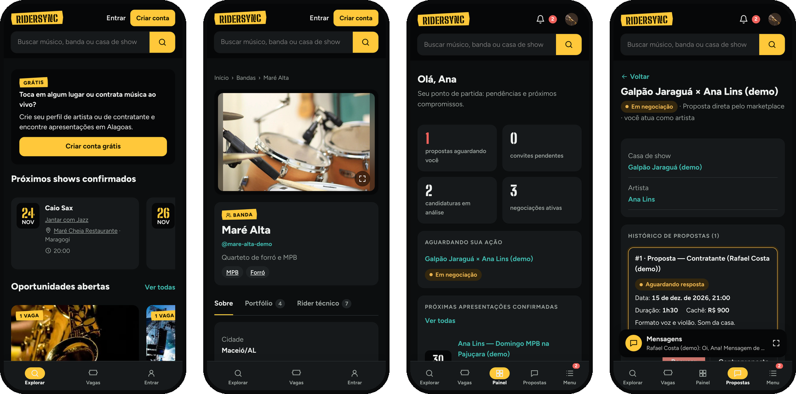
</p>

A SPA é responsiva em celular, tablet e desktop, com barra inferior de atalhos, filtros em diálogo e mensagens da
negociação em painel recolhível. Os testes E2E rodam nos três tamanhos de tela e falham se houver rolagem horizontal.

## Como a contratação funciona

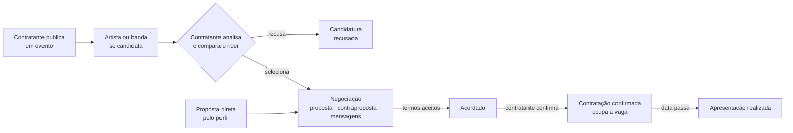

<details>
<summary><b>Ciclo de vida do evento</b></summary>

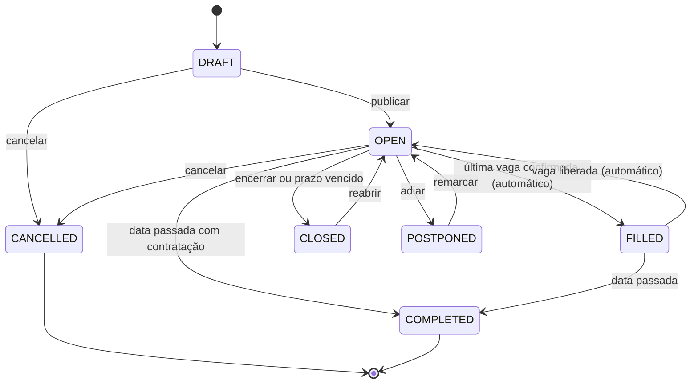

As transições automáticas rodam no backend (Cron diário e, no máximo uma vez por minuto, antes das consultas). O estado
nunca depende do frontend. Detalhes em [`docs/ARQUITETURA.md`](https://github.com/leonardobrrs/ridersync/blob/feat/evolucao-ridersync/docs/ARQUITETURA.md).

</details>

## Arquitetura

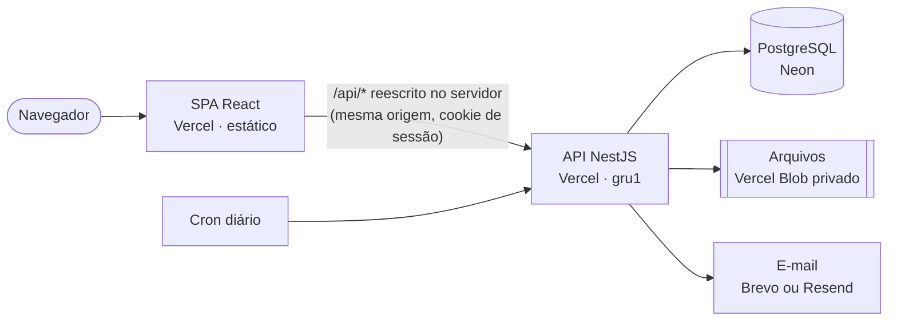

- **Um monólito modular** NestJS e **um** PostgreSQL via Prisma. Sem microsserviços, filas externas, Redis ou CQRS.
- Camadas: controllers magros (Zod), serviços com casos de uso e autorização, **regras puras** em `*.rules.ts` e
  `riders/compatibility.ts` (cobertas por testes unitários), infraestrutura isolada (banco, storage, imagem, e-mail).
- Autorização sempre no backend, por **vínculo ativo + papel**. Papel ou ID vindo do cliente nunca é confiado.
- Notificações e e-mails gravados na mesma transação da ação, com **outbox** e reenvio sem duplicidade.

<details>
<summary><b>Módulos do backend</b></summary>

| Módulo | Responsabilidade |
|---|---|
| `auth` | Cadastro com tipo de conta e aceite LGPD, login com bloqueio por tentativas, sessões, confirmação de e-mail, recuperação de senha, Google OAuth (PKCE), reautenticação |
| `account` | Dados da conta, senha, aceite de termos, exportação e exclusão/anonimização |
| `access` | Autorização por vínculo e papel, tipo de conta, destinatários de notificações |
| `artists` | Perfil individual, identidade artística (solo ou banda), portfólio |
| `bands` | Banda, convites, papéis, função do integrante, transferência de propriedade |
| `organizations` | Casas de show e perfil de contratante individual, responsáveis, convites |
| `events` | Eventos, candidaturas, vagas, ciclo de vida automático, agenda pública |
| `bookings` | Negociação, contrapropostas, mensagens, confirmação, apresentação realizada |
| `riders` | Catálogo técnico, rider do artista, inventário da casa, comparação |
| `marketplace` | Página inicial, busca e perfis públicos |
| `notifications` · `mail` | Central de notificações, preferências, outbox e transporte de e-mail |
| `media` | Upload validado por assinatura binária e reprocessamento de imagem (sharp → WebP) |
| `maintenance` | Rotina diária: transições por data, reenvio de e-mails, retenção |
| `dashboard` | Painel e agenda privada |

</details>

<details>
<summary><b>Estrutura do repositório</b></summary>

```
.
├── backend/                 API NestJS
│   ├── prisma/              schema.prisma + migrations (com CHECKs e catálogo técnico)
│   ├── seed-assets/         imagens CC0/domínio público do seed de vitrine
│   ├── src/common/          validação Zod, erros, municípios de AL, política de senha
│   ├── src/modules/         módulos de domínio (tabela acima)
│   ├── src/seed/            seeds de demonstração e vitrine (somente desenvolvimento/staging)
│   └── test/                testes de integração (Supertest + PostgreSQL)
├── frontend/                SPA React
│   ├── src/features/        telas por domínio
│   ├── src/components/      layout, campos, estados, diálogos
│   └── e2e/                 testes Playwright (desktop, tablet e celular)
├── docs/                    arquitetura, dados, LGPD, testes, deploy, decisões
└── docker-compose.yml       db + api + web
```

</details>

### Stack

| Camada | Tecnologias |
|---|---|
| **Frontend** | React 19 · TypeScript 5.9 · Vite 7 · React Router 7 · TanStack Query 5 · React Hook Form + Zod 4 |
| **Backend** | NestJS 11 · REST + Swagger · Zod 4 · Argon2id · sharp · helmet |
| **Dados** | PostgreSQL 16 · Prisma 6 (migrations versionadas, CHECKs à mão) |
| **Testes** | Jest + Supertest · Vitest + Testing Library · Playwright |
| **Infra** | Vercel (API + SPA) · Neon (PostgreSQL) · Vercel Blob · Docker Compose para desenvolvimento |

## Rodando localmente

**Pré-requisitos:** Node.js 22 LTS (≥ 22.12), npm 10+ e Docker com Compose v2 (ou Podman). Não precisa instalar PostgreSQL.

```bash
git clone git@github.com:leonardobrrs/ridersync.git
cd ridersync
npm ci                                   # instala backend e frontend (workspaces) e gera o Prisma Client
cp backend/.env.example backend/.env     # os padrões já funcionam com o banco do Docker

npm run db:up                            # PostgreSQL 16 em localhost:5432
npm run db:migrate                       # aplica as migrations (não apaga dados)
npm run db:seed:showcase                 # opcional: dados fictícios com imagens

npm run dev:api                          # terminal 1 → http://localhost:3000/api  (Swagger em /api/docs)
npm run dev:web                          # terminal 2 → http://localhost:5173
```

Abra **http://localhost:5173** e entre com uma [conta de demonstração](#contas-de-demonstração). O Vite encaminha
`/api` para a API na mesma origem, então o login por cookie funciona sem configurar CORS.

<details>
<summary><b>Tudo em containers (sem Node local)</b></summary>

```bash
docker compose up --build
API_NODE_ENV=development SEED_DEMO=true docker compose up --build   # com dados de demonstração
```

Interface em http://localhost:8080 (o nginx encaminha `/api`) e API em http://localhost:3000/api. Portas configuráveis
por `POSTGRES_PORT`, `API_PORT` e `WEB_PORT`. Para parar use `docker compose down` — **sem** `-v`, que apaga o banco.

</details>

<details>
<summary><b>Usando Podman</b></summary>

```bash
systemctl --user start podman.socket
export DOCKER_HOST=unix:///run/user/$UID/podman/podman.sock
docker compose up -d db
```

Em sistemas com SELinux, o bind mount do script de init já usa o rótulo `:z`.

</details>

<details>
<summary><b>Problemas comuns</b></summary>

| Sintoma | Solução |
|---|---|
| `Configuração de ambiente inválida: DATABASE_URL` | falta o `backend/.env` |
| `Can't reach database server at localhost:5432` | banco parado: `npm run db:up` e confira `docker compose ps` |
| `port 5432 is already allocated` | `POSTGRES_PORT=5433 npm run db:up` e ajuste a porta em `DATABASE_URL` |
| Login e listas falham na interface | a API não está rodando no :3000 |
| Client do Prisma desatualizado | `npm run prisma:generate -w backend` |
| Erro `CSRF` no curl/Postman | requisições de escrita exigem `X-Requested-With: RiderSync` |
| `Port 5173 is in use` | feche o outro Vite (a porta é fixa por causa do proxy) |

</details>

As variáveis de ambiente são validadas na inicialização. Lista completa em
[`docs/VARIAVEIS_DE_AMBIENTE.md`](https://github.com/leonardobrrs/ridersync/blob/feat/evolucao-ridersync/docs/VARIAVEIS_DE_AMBIENTE.md).

## Contas de demonstração

Criadas por `npm run db:seed` (ou `db:seed:showcase`). Dados **fictícios**, somente para desenvolvimento e staging.
Senha de todas: `Demo@RiderSync2026`.

| E-mail | Tipo | Papel na demo |
|---|---|---|
| `ana@demo.ridersync.local` | artista | Perfil público, proprietária da banda Maré Alta, shows confirmados |
| `davi@` · `lia@demo.ridersync.local` | artista | Administrador e integrante da Maré Alta (Lia só visualiza) |
| `joao@demo.ridersync.local` | artista | Dono do Trio Agreste, com convite pendente para a Maré Alta |
| `rafael@demo.ridersync.local` | contratante | Galpão Jaraguá: inventário, eventos em vários estados, negociações |
| `marina@` · `helena@demo.ridersync.local` | contratante | Casa Sururu e Teatro Ribeirinho |
| `carla@` · `eduardo@demo.ridersync.local` | contratante | Contratantes independentes (eventos particulares) |

O seed de vitrine acrescenta 17 artistas e bandas, 9 casas, 27 eventos, candidaturas, negociações e imagens
(créditos em `backend/seed-assets/showcase/CREDITS.json`). Roteiro passo a passo em [`docs/DEMO.md`](docs/DEMO.md);
lista completa de contas em [`docs/SEEDERS.md`](https://github.com/leonardobrrs/ridersync/blob/feat/evolucao-ridersync/docs/SEEDERS.md).

## Testes

| Suíte | Ferramenta | Resultado |
|---|---|---|
| Backend — unitários e integração | Jest + Supertest em PostgreSQL real | **201 passando** |
| Frontend — unitários | Vitest + Testing Library | **13 passando** |
| End-to-end | Playwright em desktop, tablet (820 px) e celular (Pixel 7) | **17 passando** |

```bash
npm run lint && npm run typecheck
npm test                 # Jest (backend) + Vitest (frontend)
npm run test:e2e         # Playwright com API e SPA isoladas no banco ridersync_e2e
npm run build
```

Os testes de integração só rodam contra o banco `ridersync_test` e se recusam a usar qualquer outro. Pré-requisitos e
o que cada suíte cobre em [`docs/TESTES.md`](https://github.com/leonardobrrs/ridersync/blob/feat/evolucao-ridersync/docs/TESTES.md).

## Deploy

| Peça | Serviço |
|---|---|
| API | Vercel, região `gru1` (NestJS) |
| Interface | Vercel (Vite estático), com `/api/*` reescrito para a API no servidor |
| Banco | Neon PostgreSQL (branch `ridersync-staging`) |
| Arquivos | Vercel Blob (store privado) |
| Rotina diária | Vercel Cron |

O ambiente de staging é publicado a partir da branch `feat/evolucao-ridersync` e é protegido por login na Vercel.
Passo a passo em [`docs/VERCEL_SETUP.md`](docs/VERCEL_SETUP.md) e [`docs/NEON_SETUP.md`](docs/NEON_SETUP.md).

## Segurança e LGPD

- Sessão no servidor com cookie `HttpOnly`/`SameSite=Lax` (`Secure` em produção); o token fica salvo só como hash
- Senhas com **Argon2id** (contas antigas em scrypt migram no próximo login) e bloqueio por tentativas
- CSRF por cabeçalho e verificação de `Origin`; CORS por lista explícita; rate limit nas rotas sensíveis
- Validação Zod de toda entrada; consultas públicas com `select` explícito; erros sem detalhes internos
- Uploads validados pela assinatura binária e reencodados sem metadados (EXIF/GPS)
- Política de privacidade e termos versionados, exportação de dados, exclusão com anonimização e política de retenção

Inventário de dados, bases legais e direitos do titular em [`docs/LGPD.md`](https://github.com/leonardobrrs/ridersync/blob/feat/evolucao-ridersync/docs/LGPD.md).

## Documentação

| Documento | Conteúdo |
|---|---|
| [`ARQUITETURA.md`](https://github.com/leonardobrrs/ridersync/blob/feat/evolucao-ridersync/docs/ARQUITETURA.md) | Módulos, camadas, máquinas de estado, visibilidade, notificações |
| [`MODELO_DE_DADOS.md`](https://github.com/leonardobrrs/ridersync/blob/feat/evolucao-ridersync/docs/MODELO_DE_DADOS.md) | Entidades, migrations e índices |
| [`DECISOES_TECNICAS.md`](docs/DECISOES_TECNICAS.md) | Decisões de modelo, permissões, estados, segurança e armazenamento |
| [`RELATORIO_EVOLUCAO.md`](https://github.com/leonardobrrs/ridersync/blob/feat/evolucao-ridersync/docs/RELATORIO_EVOLUCAO.md) | Situação de cada requisito, limitações conhecidas e pendências |
| [`LGPD.md`](https://github.com/leonardobrrs/ridersync/blob/feat/evolucao-ridersync/docs/LGPD.md) | Proteção de dados pessoais |
| [`TESTES.md`](https://github.com/leonardobrrs/ridersync/blob/feat/evolucao-ridersync/docs/TESTES.md) · [`CHECKLIST_TESTES_MANUAIS.md`](https://github.com/leonardobrrs/ridersync/blob/feat/evolucao-ridersync/docs/CHECKLIST_TESTES_MANUAIS.md) | Testes automatizados e roteiro manual |
| [`VARIAVEIS_DE_AMBIENTE.md`](https://github.com/leonardobrrs/ridersync/blob/feat/evolucao-ridersync/docs/VARIAVEIS_DE_AMBIENTE.md) · [`PROVEDORES_EXTERNOS.md`](https://github.com/leonardobrrs/ridersync/blob/feat/evolucao-ridersync/docs/PROVEDORES_EXTERNOS.md) | Configuração e integrações (e-mail, Google, Cron) |
| [`VERCEL_SETUP.md`](docs/VERCEL_SETUP.md) · [`NEON_SETUP.md`](docs/NEON_SETUP.md) | Deploy e banco |
| [`SEEDERS.md`](https://github.com/leonardobrrs/ridersync/blob/feat/evolucao-ridersync/docs/SEEDERS.md) · [`DEMO.md`](docs/DEMO.md) | Dados de demonstração e roteiro |
| Swagger | `http://localhost:3000/api/docs` |

## Escopo atual

**Fora do escopo por decisão do projeto:** processamento de pagamentos, editais e oportunidades culturais (adiados),
recomendações por IA, substituição automática de equipamentos e avaliações.

---

<p align="center">
  <sub><b>RiderSync</b> · projeto acadêmico desenvolvido no Projetão da Universidade Federal de Alagoas<br>
  Imagens de demonstração com licença CC0 ou domínio público · todos os dados exibidos são fictícios</sub>
</p>
